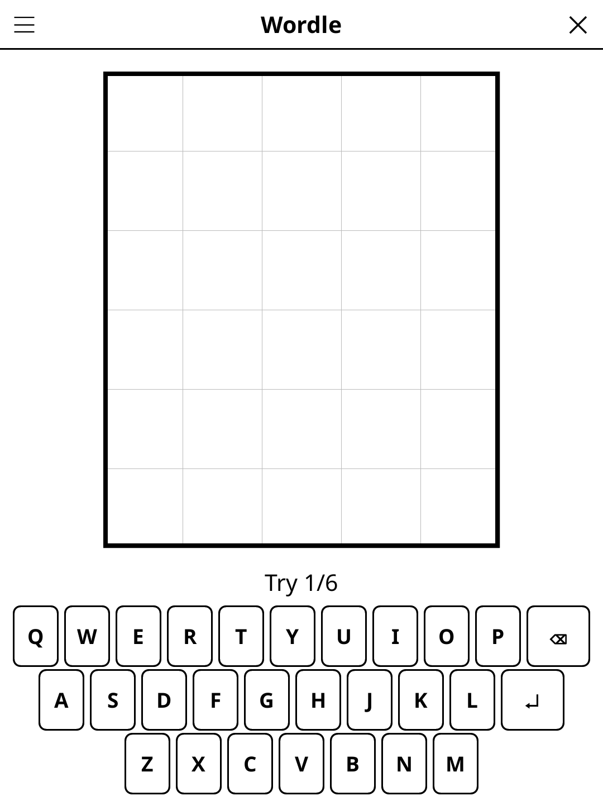

# wordle.koplugin

A Wordle plugin for [KOReader](https://github.com/koreader/koreader).

## Screenshot

## Rules

Guess the secret 5-letter word in 6 attempts. After each guess, tiles reveal: **green** = right letter right spot; **yellow** = right letter wrong spot; **grey** = letter not in word. The keyboard tracks used letters.

## Concept

Guess the hidden 5-letter word in 6 attempts. After each guess, each letter is marked:
- **Correct** — right letter, right position
- **Present** — letter is in the word but in the wrong position
- **Absent** — letter is not in the word

## Features

- **Two languages** — EN and FR
- **Separate answer and guess lists (EN)** — 2,307 common words can be the answer, while 8,637 are accepted as guesses, so ordinary English words are never rejected as "not a word"
- **On-screen keyboard** — shows letter status at a glance
- **Hard mode** — revealed hints must be used in subsequent guesses
- **Daily puzzle** — one puzzle per day derived from the date (reproducible seed)
- **Free play** — unlimited random puzzles
- **Statistics** — win streak, guess distribution histogram
- **Auto-save** — resume an in-progress game after closing KOReader

## Multiplayer

Pick **Wordle · multiplayer** (Tools → Games → Party & quiz), or *Mode:
Multiplayer* in the game menu, and lay the reader in the middle of the table.
2 to 4 teams share one grid and take turns, one row each; the team to play is
shown in big type with the scores under it.

- **First letter shown** (on by default): every row starts with the word's
  first letter, locked in place.
- A word that is not in the word list is refused and **the turn passes** to the
  next team (no row is used up); a word too short is just refused.
- The team that finds the word scores **the rows left**: 6 points on the first
  row, 5 on the second … 1 on the sixth.
- If the grid fills up, the word is revealed and nobody scores.
- A match is 3, 5, 7 or 10 words (*Rounds*); each word another team starts.
  Team names are remembered; the match is saved when you leave and does not
  touch your solo game.

## Controls

| Action | How |
|--------|-----|
| Type a letter | Tap the on-screen keyboard |
| Delete last letter | Tap **⌫** |
| Submit guess | Tap **Enter** |
| New random game | Tap **New game** |
| Show rules | Tap **Rules** |

## Why e-ink friendly?

Each guess is a discrete, low-frequency interaction. The letter-status feedback
uses distinct fill patterns (solid / hatched / empty) instead of colours alone,
so the puzzle remains readable on greyscale e-ink screens.

## License

GPL-3.0
